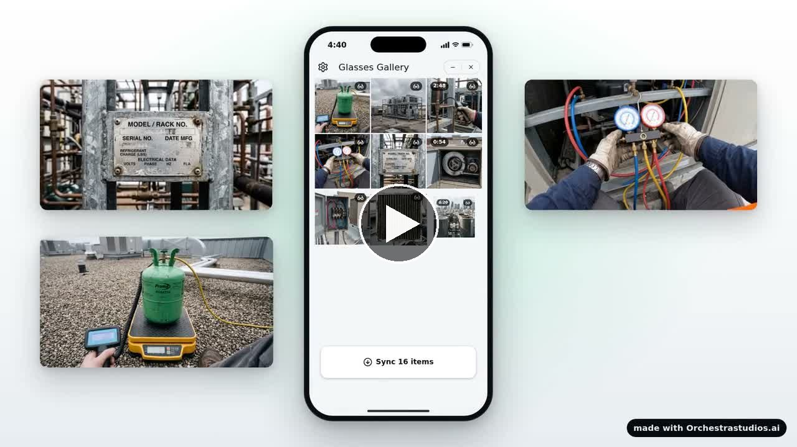
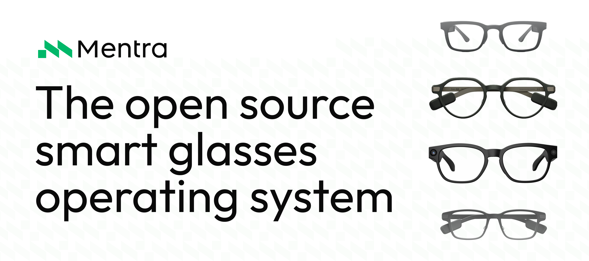
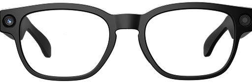
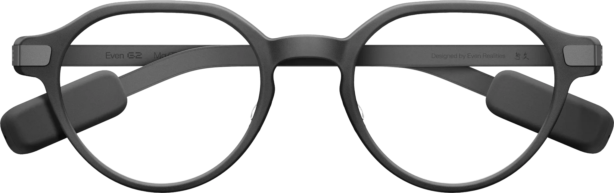
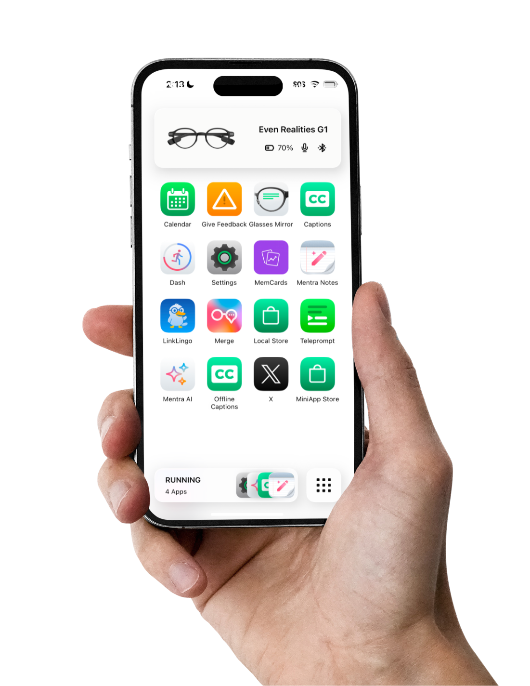
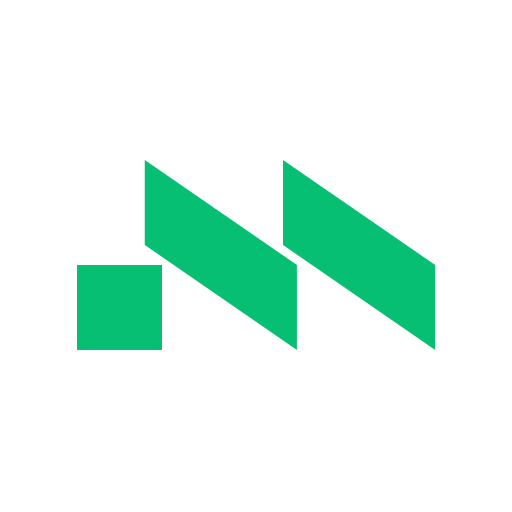

https://github.com/user-attachments/assets/568d639a-5564-4189-8751-e125b4775289

## 🎬 We made Mentra a film

Hi Mentra team — I'm Remy Tennant, founder of Orchestra Studios. This is a gift — a film we made specially for your company, directed from your product itself: your actual screens, in motion.

We're running a promotional campaign: **we're giving away 100 videos to YC companies over the next 30 days, first come, first served.** We came to you first because we admire MentraOS's "write once, run on any smart glasses" promise — handling pairing, streaming and hardware access across manufacturers so a glasses app goes from months to days, with live captions, translation and AI notes in the MiniApp Store. So we went ahead and made yours — the short film above. I think it came out great, and I'd love you to have it.

**Use it as-is, or claim it and get the real thing:**
- This copy is yours either way. Want just the video? Trim the outro card off the end and use it — no signup, no strings. It's 720p only because GitHub caps README videos at 10 MB; that's the whole reason, not a teaser.
- **Claim it at [orchestrastudios.ai/YC](https://orchestrastudios.ai/YC)** and you get the full 1080p master — plus the project itself, transferred to you the moment you sign up.
- Claiming means the film becomes *code you own*, not a file you're stuck with: edit any scene, line or voice, re-audition, re-render as often as you like. When your product changes, it can re-render from your code, so it never goes stale.
- Want changes? Just tell me what you'd fix — I'll hand it to the AI agent embedded in the project. It makes the edits and re-renders. First round's on us, no sweat.

**No strings attached.** No card, no sales call, no deadline on the gift itself — the film above is yours whether or not you ever claim the project. Why free? Orchestra just launched, and this is our launch campaign: we're giving a film to 100 YC companies, first come first served. We're YC founders ourselves, so we started with our own community — and a claimed project is worth more to us than a fee. That's the whole exchange.

Questions? Email me at **remy@orchestrastudios.ai**.

— Remy Tennant
Orchestra Studios

---

  

  

    <a href="https://mentra.glass">Website</a> •
    <a href="https://docs.mentra.glass">Documentation</a> •
    <a href="https://apps.mentraglass.com/submit">Submit a miniapp</a> •
    <a href="https://apps.mentraglass.com">Mentra Miniapp Store</a>
  

  <!--
  

    
    
    
    
    
  

  -->

  
  

## Write Once, Run on Any Smart Glasses

MentraOS is how developers and businesses build smart glasses apps.

MentraOS handles pairing, connection, data streaming, hardware access, and cross-device compatibility, so you can focus on building amazing apps. Development goes from months to days.

Every component is open source under the Apache License 2.0, giving you privacy, freedom, and control.

## Supported Smart Glasses

**Officially supported: Mentra Live and Even Realities G2.**

  <table border="0" cellspacing="0" cellpadding="0" width="100%" style="border: 0 !important; border-collapse: separate; border-spacing: 8px;">
    <tbody>
      <tr style="border: 0 !important; background: transparent;">
        <td align="center" valign="top" width="50%" style="border: 1px solid #e5e7eb; border-radius: 14px; padding: 24px 12px 12px; background: #ffffff;">
           
          
            
          
<b>Mentra Live</b>

        </td>
        <td align="center" valign="top" width="50%" style="border: 1px solid #bbf7d0; border-radius: 14px; padding: 24px 12px 12px; background: #ffffff;">
           
          
            
          
<b>Even Realities G2</b>

        </td>
      </tr>
    </tbody>
  </table>

Official support for Even Realities G1, Vuzix Z100, and Mentra Mach1 has ended; their existing code remains available.

## Why Build with MentraOS?

- **Cross-Compatibility:** Build one app that runs on supported smart glasses from multiple manufacturers.
- **Fast Development:** Go from months of custom smart glasses development to a working app in days.
- **Hardware Access:** Use displays, microphones, cameras, speakers, and everything else smart glasses expose from one API.
- **App Distribution:** Publish to the Mentra MiniApp Store and reach users across the MentraOS ecosystem.
- **Business Deployment:** Deploy smart glasses apps for field work, remote support, training, accessibility, and compliance-sensitive workflows. MentraOS is already being deployed by Fortune 500 companies.
- **Open Source Control:** Own it, host it, modify it, and extend it. MentraOS is Apache-2.0-licensed infrastructure designed for privacy, transparency, and freedom from hardware or cloud lock-in.

## Apps on the Mentra MiniApp Store

Browse, install, and run glasses apps from your phone. Try captions, AI notes, proactive AI, translation, streaming, and more.

  

## How MentraOS Works

MentraOS runs glasses apps on the phone inside the Mentra Runtime. Multiple glasses apps can run simultaneously, controlling your smart glasses through one shared connection.

This keeps the glasses lightweight while letting multiple apps run together, like captions, notes, notifications, dashboard, and AI tools. It also allows one app to work with any pair of supported smart glasses.

Manufacturers can integrate the Mentra Runtime into their own iOS and Android apps to unlock the Mentra ecosystem while preserving their brand, app, and customer relationship.

## Nightly Builds

  

    
    
  

## Community

MentraOS is built by developers, companies, and users who believe the next personal computer should be open, cross-compatible, private, and user-controlled.

Join us and become part of the Mentra Community by joining our Discord server:  
[https://mentra.glass/discord](https://mentra.glass/discord)

## Contributing

MentraOS is made by a community and we welcome pull requests.

**Contributor guide:**  
[https://docs.mentraglass.com/os-devs/contributing/overview](https://docs.mentraglass.com/os-devs/contributing/overview)

Looking for ways to contribute? We mark issues we'd love the community to help with using the "Help Wanted" tag.

**Help wanted issues:**  
[https://github.com/Mentra-Community/MentraOS/issues?q=is%3Aissue%20state%3Aopen%20label%3A%22help%20wanted%22](https://github.com/Mentra-Community/MentraOS/issues?q=is%3Aissue%20state%3Aopen%20label%3A%22help%20wanted%22)

## Contact

- **Email:** [team@mentra.glass](mailto:team@mentra.glass)
- **Discord:** [https://mentra.glass/discord](https://mentra.glass/discord)
- **X:** [https://x.com/mentraglass](https://x.com/mentraglass)

## License

Apache License 2.0

Copyright 2026 Mentra Labs, Inc.

   
  
  <h3>© 2026 Mentra Labs, Inc.</h3>

