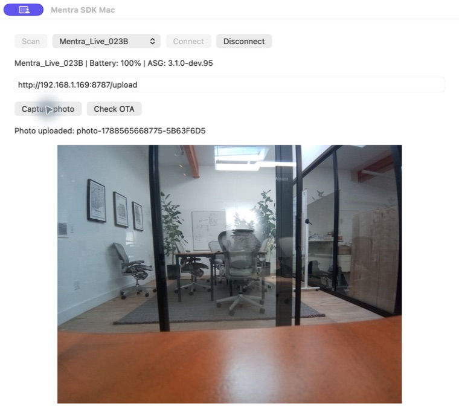
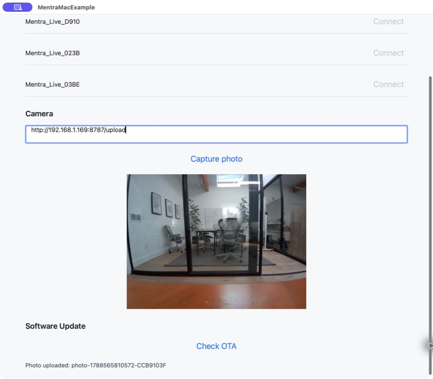
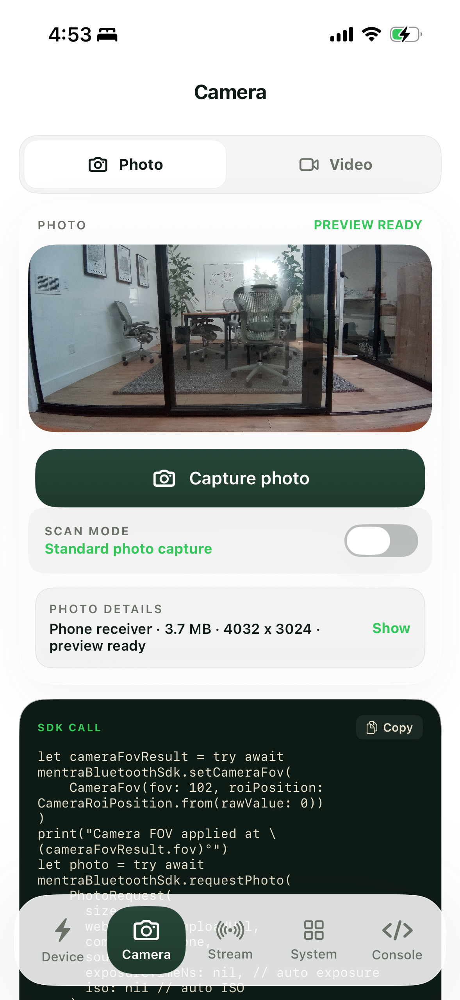
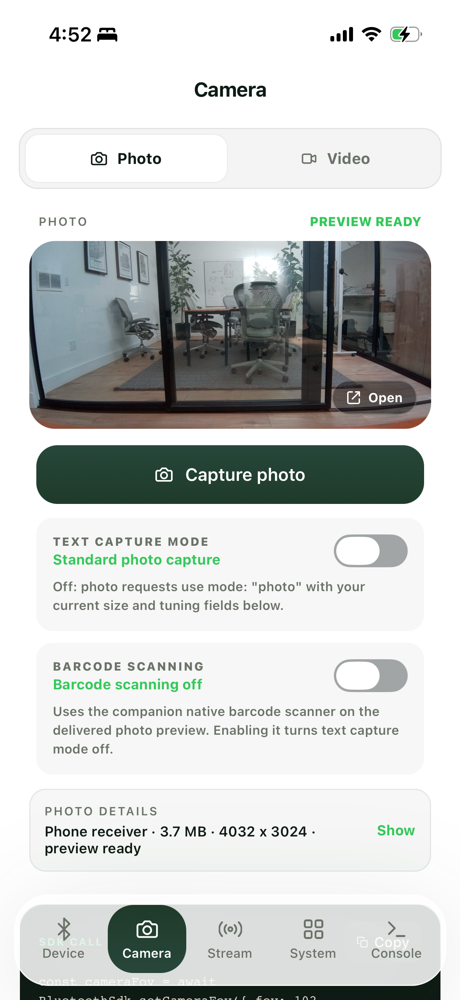
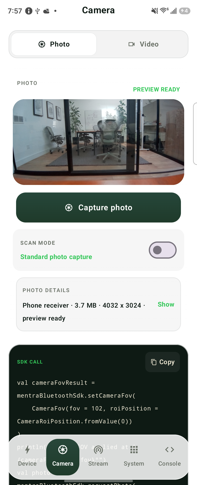
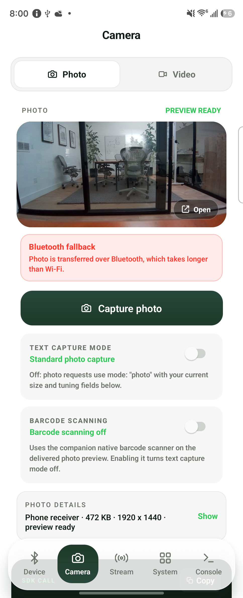

# Mentra Bluetooth SDK Starter Kit

Documentation and example apps for connecting to smart glasses directly from mobile apps over Bluetooth, powered by MentraOS. This is the supported Mentra Bluetooth SDK for mobile apps and works with MentraOS compatible glasses, including Mentra Live, Even Realities, Vuzix Z100, NIMO, and more.

The SDK is available in these first-class forms:

| Platform | Package | Example |
| --- | --- | --- |
| Android | `com.mentraglass:bluetooth-sdk` | [`android`](android/README.md) |
| iOS | `MentraBluetoothSDK` Swift package | [`ios`](ios/README.md) |
| Native macOS (AppKit / SwiftUI) | `MentraBluetoothSDK` Swift package | [`macos`](macos/README.md) |
| React Native / Expo | `@mentra/bluetooth-sdk` | [`react-native`](react-native/README.md) |
| React Native macOS | `@mentra/bluetooth-sdk` | [`react-native-macos`](react-native-macos/README.md) |

Use the latest SDK version published by Mentra for your app. Native macOS
support is separate from running the iOS TestFlight app on an Apple silicon Mac.

## In MentraOS

This folder, `examples/bluetooth` in
[MentraOS](https://github.com/Mentra-Community/MentraOS), is the source of the
Starter Kit. Here every example builds against the SDK source in the same
checkout, with no published packages and no version pins:

| Example | How it gets the SDK |
| --- | --- |
| `android` | Gradle composite build of `mobile/modules/bluetooth-sdk/android`, substituted for `com.mentraglass:bluetooth-sdk` |
| `ios`, `macos` | Local Swift package `mobile/modules/bluetooth-sdk` |
| `react-native`, `react-native-elevenlabs-audio`, `react-native-macos` | Members of the `examples/` Bun workspace; `@mentra/*` are `workspace:*` links to `mobile/modules` and `cloud-v2/packages` |

Paths in this folder's docs are relative to the Starter Kit root, which is
`examples/bluetooth` in MentraOS. The `Example App Builds` workflow in MentraOS
builds every example on changes to them or to the SDK.

The standalone
[Starter Kit repository](https://github.com/Mentra-Community/Mentra-Bluetooth-SDK-Starter-Kit)
is generated from this folder, with the SDK dependencies pinned to published
versions so it can be cloned and built without a MentraOS checkout. A scheduled
MentraOS workflow keeps each kit branch on its channel's latest completed
release: it pushes one `Release <version>` commit and an `sdk-<version>` tag,
and records the inputs in `starter-kit-release.json`. Intermediate releases are
skipped; an older release is exported only by a manual dispatch with its
identity. The kit repository keeps its own CI, which builds the
examples from the published packages.

## Documentation

Read the first-party [Mentra Live Bluetooth SDK docs](https://docs.mentraglass.com/mentra-live).

## Start Here

1. Read [Getting Started](docs/getting-started.md) for install, permissions, and minimal connection flows.
2. Run the example that matches your app stack:
   - [Android Kotlin / Jetpack Compose](android/README.md)
   - [iOS SwiftUI](ios/README.md)
   - [Native macOS AppKit](macos/README.md)
   - [React Native / Expo](react-native/README.md)
   - [React Native macOS](react-native-macos/README.md)
   - [React Native ElevenLabs audio repro](react-native-elevenlabs-audio/README.md)
3. Keep [API Reference](docs/api-reference.md), [Display Guide](docs/display-guide.md), [Audio Guide](docs/audio-guide.md), and [Hardware Integration Notes](docs/hardware-integration.md) nearby while building.
4. Use [Troubleshooting](docs/troubleshooting.md) and the [Production Checklist](docs/production-checklist.md) before shipping.

## Install Prebuilt Example Apps

Installable builds of the examples for each SDK release are listed on that
release's page in [MentraOS releases](https://github.com/Mentra-Community/MentraOS/releases)
(`mentra-v<version>`), under **Bluetooth example apps**. Each filename carries
its SDK version, for example `mentra-example-react-native-<version>.apk`. Android APKs install directly from
the phone browser (enable installs from unknown sources when prompted). The iOS
IPA is unsigned; install it with a sideloading tool such as
[Sideloadly](https://sideloadly.io/) or [AltStore](https://altstore.io/), which
re-signs it with your own Apple ID. In MentraOS, the `Example App Builds`
workflow keeps the Android APKs it builds as run artifacts for 14 days.

## What The Examples Demonstrate

- Scanning for supported Mentra glasses, connecting, disconnecting, and reconnecting to a saved/default device.
- Reading typed lifecycle state for glasses, SDK runtime, and scan progress.
- Displaying text, clearing the display, and opening the dashboard on display-equipped models such as G2.
- Checking Mentra Live OTA availability and showing update progress/status.
- Handling button, touch, swipe, head-up, battery, Wi-Fi, hotspot, stream, photo, video upload, OTA, audio, and SDK diagnostic events.
- Controlling model-supported features such as brightness, dashboard position, head-up angle, gallery mode, button photo/video settings, speaker playback, RGB LED patterns, Wi-Fi, hotspot, microphone, camera capture settings, and streaming.
- Running local media upload and RTMP/SRT/WebRTC streaming demos from a fresh clone.

## Photo Capture Screenshots

Real photos taken with Mentra Live and previewed in each app, captured on physical
hardware. Click a screenshot for the full-size image.

| Native macOS (AppKit) | React Native macOS |
| --- | --- |
|  |  |

| Native iOS (SwiftUI) | React Native on iOS |
| --- | --- |
|  |  |

| Native Android (Kotlin / Compose) | React Native on Android |
| --- | --- |
|  |  |

The React Native Android capture also demonstrates successful Bluetooth fallback
when Wi-Fi photo delivery fails.

The [ElevenLabs audio repro](react-native-elevenlabs-audio/README.md) is
audio-only and has no camera preview. See the [capture notes](docs/images/examples/README.md)
for screenshot provenance.

## Repository Map

- `docs/getting-started.md`: package install and first connection for Android, iOS, and React Native.
- `docs/api-reference.md`: public API shape, command/event lifecycle, and cross-platform model names.
- `docs/display-guide.md`: text, dashboard, and display-related settings.
- `docs/audio-guide.md`: microphone events, LC3/PCM, local transcription, playback route, and glasses media volume.
- `docs/hardware-integration.md`: model differences and capability gating.
- `docs/mentra-live-ble-wire-protocol.md`: Mentra Live BLE wire v2, K900 endian negotiation, and SDK/firmware pairing notes.
- `docs/production-checklist.md`: release-readiness checklist.
- `docs/troubleshooting.md`: build, permission, scan, stream, and React Native issues.
- `local-demo-cloud`: recommended local helper for media upload and stream preview.
- `react-native-elevenlabs-audio`: focused Mentra Live PCM to ElevenLabs WebSocket repro app.
- `photo-webhook-server`: focused media upload webhook server.
- `local-webrtc-server`: lower-level MediaMTX helper.

## Touchpad default actions (OS-2123)

The React Native, Android and iOS examples put eight **Touchpad default actions**
switches in the **System** tab beside gallery mode. An enabled switch allows the
glasses’ built-in action; disabling it retains touch events for your app. Values
change only after a settings acknowledgement and reset when BLE disconnects.
The controls are available for Mentra Live and require firmware with `cs_tpdef`.

`setTouchGestureDefaultBehaviorEnabled` is available from SDK `3.4.0-dev.947`
on npm, Maven Central and Swift Package Manager
([SDK PR #4802](https://github.com/Mentra-Community/MentraOS/pull/4802)).

To verify on glasses, connect Mentra Live, open System, disable **Double tap**, and
double tap while media is paused and while it is playing. The touch event should
still appear, and media should retain its state. Enable the switch and verify the
stock action returns. Repeat for other gestures, then reconnect and confirm all
switches return to enabled. A failed or timed-out setting must retain its previous
value. This physical verification has not been run yet.
